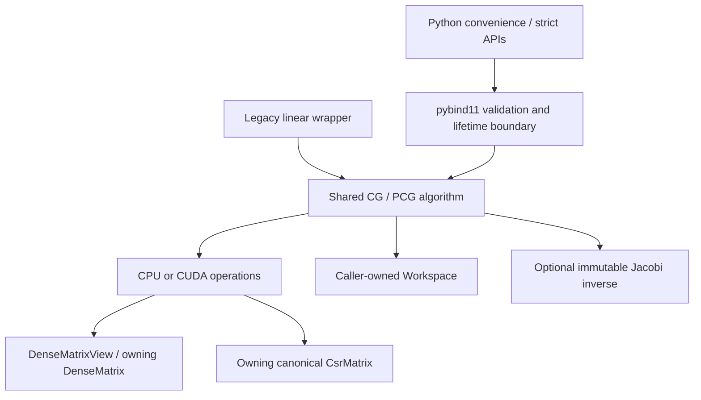

# Solver architecture

The core separates numerical storage, execution, solver state, and language bindings. Dense and CSR operators use the same CG/PCG implementation; neither matrix class owns a solver or a thread policy.

| Layer | Responsibility |
| --- | --- |
| `include/cg/storage.hpp` | Borrowed const/mutable views, owning dense/vector storage, reusable workspace. Views retain no Python owner. |
| `include/cg/csr.hpp` | Owning, validated CSR with sorted unique columns, float64 values, and `size_t` indices. Storage is immutable after construction. |
| `include/cg/backend.hpp` | Synchronous CPU operations and per-instance thread/fusion/dense-kernel settings. No process-wide thread changes. |
| `include/cg/preconditioner.hpp` | Validate and cache a positive Jacobi inverse; apply it through backend operations. |
| `include/cg/solver.hpp` | Shared stopping rules, recurrence, refresh/restart, failure status, and operation counts. |
| `include/cg/detail/solver_engine.hpp` | Common CG/PCG engine instantiated by CPU and CUDA operation adapters. |
| `include/cg/cuda.hpp` | Device-owned dense/CSR/vector storage, borrowed stream context, device workspace and native/cuBLAS operations. |
| `bindings/cpu.cpp` | Strict array validation, prepared snapshots, owner lifetimes, GIL release, and a concurrent-use guard on Python workspace. |
| `bindings/cuda.cpp` | CUDA Array Interface validation, device ownership, producer readiness, GIL release and synchronous completion. |
| `python/cgpy` | Convenience conversion and result ownership; strict and prepared APIs expose reuse explicitly. |
| `python/cgbench` | Shared pytest fixtures, independent accuracy checks, balanced scheduling, and raw artifacts. |

## Workspace and ownership

Workspace owns five vectors: residual `r`, direction `p`, product `Ap`, true-residual scratch, and preconditioned residual `z`. Prepare its size before calling the native solver. The native core with a prepared preconditioner does not allocate vector storage. Standalone Python calls with Jacobi construct its inverse diagonal for that call. Keep the output and workspace disjoint from all inputs; use one workspace and output per concurrent solve.

`solve` normalizes array-like inputs and allocates the result and workspace. `solve_into` borrows compatible arrays and uses caller-owned output/workspace. `prepare` owns a matrix snapshot and an optional Jacobi inverse, so repeated solves can share those immutable objects. Preparation fixes its thread count and dense-kernel choice. Each API call is synchronous; borrowed arrays must remain alive and free from conflicting mutation until it returns. The binding releases the GIL only around the native solve.

## Operations and numerical policy

The backend exposes primitive operations and selected fused operations: matvec with `pᵀAp`, solution/residual update with residual reduction, and Jacobi application with `rᵀz`. `fused=False` keeps a separate-operation reference path. Fusion changes data traversal and summation order; it does not select the CG algorithm.

Dense fused row reductions use independent accumulators to permit vectorization without fast-math or host-specific compiler flags. Odd tails and padded row strides are supported; tests compare against long-double sums and retain non-finite multiplication behavior. `make pyprof PYPROF_ARGS='--no-fused'` selects the native reference path for measurement.

The explicit `dense_kernel="blas"` option delegates dense matrix-vector products to the optional private sequential LP64 OpenBLAS provider. It accepts one CPU thread, rejects CSR operators, and preserves the selected vector fusion policy. `dense_kernel="native"` remains the default. Provider capability/configuration is reported by the imported extension, and distribution checks exercise both modes. The build keeps provider downloads and products under the project and statically includes private symbols in BLAS wheels.

Standard CG and Jacobi PCG share the recurrence. PCG uses `z=M⁻¹r` and `rᵀz`, while convergence always uses the Euclidean true residual. Periodic replacement restarts the direction from the recomputed residual (or its preconditioned value). Candidate convergence and final results are verified even when periodic refresh is disabled. The explicit legacy algorithm remains selectable and does not support Jacobi.

Stable norm evaluation prevents false zero residuals from squared-sum underflow. Required inner products still use ordinary float64 arithmetic: an unusable product returns `non_finite`, even if the inputs and reported residual are finite. This is deliberate failure reporting, not arbitrary-scale arithmetic support. SPD remains a caller precondition.

## CUDA execution

CUDA is an optional separate `cg_cuda` target and `_cgcuda` extension. CPU builds remain independent of the CUDA toolkit and runtime. `cgpy.cuda` is safe to import on CPU-only builds and loads the declared public NVIDIA runtime/cuBLAS packages explicitly when available. Backend and dense-kernel selection remain explicit.

The shared solver engine uses CUDA operations on device-owned dense or canonical CSR matrices. Dense execution selects project kernels or cuBLAS GEMV; CSR uses project kernels. A CUDA workspace owns five vectors, reduction buffers, pinned scalar storage and a cuBLAS handle on one device/borrowed stream. Each overlapping solve requires its own workspace/output; prepared matrix and Jacobi snapshots can be shared. Calls finish before returning and restore the caller's current device. External CUDA arrays retain their owners through GIL release and must be free from conflicting mutation; v3 producer stream dependencies are honored, while v2 requires caller-established readiness.

Explicit host upload/download methods keep transfer costs visible. Prepared/API benchmarks use resident device input, charge initial-vector reset and completed solve wall time, and record host upload/setup separately. Neither scope is a host-to-host end-to-end comparison. See the [CUDA guide](cuda.rst) for exact API, lifetime, installation and measurement contracts.

## Validation

GoogleTest covers native ownership, aliasing, kernels, CSR validation, and CG/PCG breakdown. Pytest covers conversion, strict arrays, snapshots, GIL/workspace behavior, and the benchmark contract. CMake presets isolate serial, OpenMP, BLAS, CUDA, debug, and CPU sanitizer builds. Sphinx imports the real extension and checks executable documentation examples. CI checks formatting, static analysis, native/Python tests, sparse comparison artifacts, documentation, and source-distribution-to-wheel installs outside the checkout. Distribution checks exercise native/BLAS/CUDA modes, inspect installed dependencies and RPATH, and execute GPU smoke cases when a device is available. Hosted CUDA jobs compile without a GPU and report device skips; an opt-in self-hosted GPU workflow requires execution on a real device. Timing thresholds require a stable dedicated machine.
